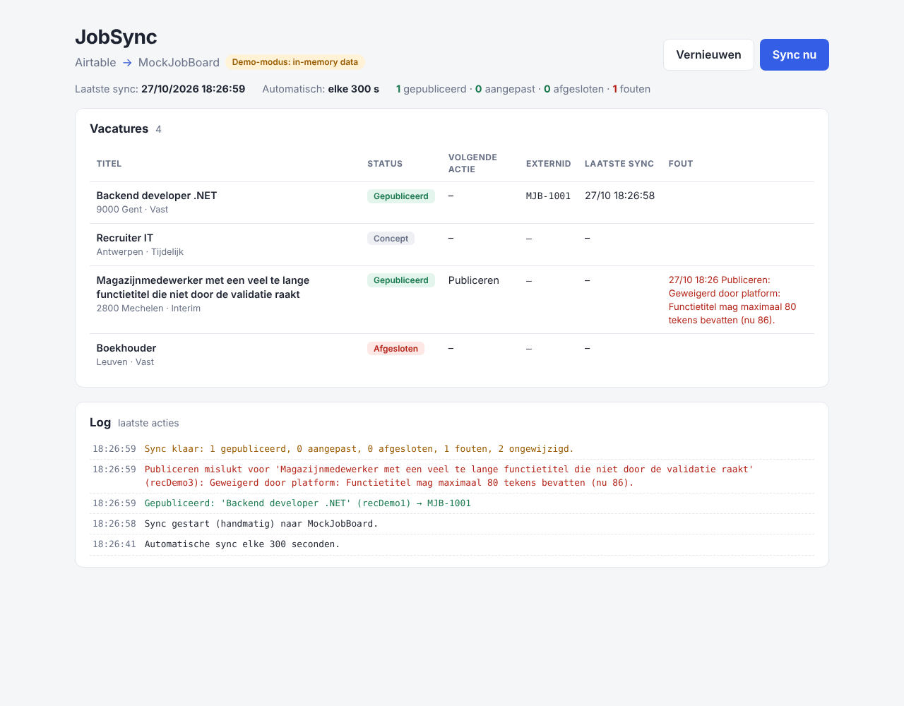
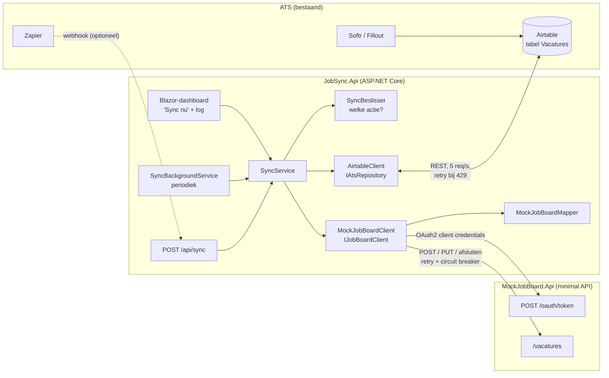

# JobSync – vacatures uit Airtable synchroniseren naar een vacatureplatform

Proof of concept in **.NET 10** dat vacatures uit een Airtable-ATS leest en ze automatisch
**publiceert, aanpast en afsluit** op een vacatureplatform. Het platform is hier een
**mock-API** met een eigen, fictief schema, omdat er (nog) geen toegang is tot de echte
VDAB-API. De koppeling zit achter een interface, zodat een echte VDAB- of Indeed-client
later ingeplugd kan worden zonder de sync-logica te wijzigen.



## Waarom

Een ATS op Airtable + Softr + Fillout + Zapier werkt goed voor de dagelijkse flow, maar
een betrouwbare koppeling met een externe vacature-API vraagt meer dan een Zap:
authenticatie met tokens, retries bij tijdelijke fouten, rate limits, idempotentie
(geen dubbele vacatures) en foutmeldingen die terug in Airtable belanden, zodat de
recruiter ziet wat er mis is. Dit project toont hoe dat er in .NET uitziet.

## Architectuur



**Belangrijkste keuzes**

| Onderdeel | Waarom |
|---|---|
| `IJobBoardClient` | Contract voor een vacatureplatform. `SyncService` kent enkel deze interface. VDAB of Indeed = nieuwe implementatie + één regel registratie in `Program.cs`. |
| `IAtsRepository` | Dezelfde gedachte aan de ATS-kant. Maakt de sync testbaar met nep-implementaties en laat een in-memory demo-modus toe. |
| `MockJobBoardMapper` | Mapping van Airtable-velden naar het platformformaat als pure functie: geen I/O, eenvoudig te testen. Elke platformclient heeft zijn eigen mapper. |
| `SyncBeslisser` | Beslist per vacature *wat* er moet gebeuren. Ook een pure functie en dus volledig getest. |
| `Microsoft.Extensions.Http.Resilience` | Retries met exponential backoff + jitter, respecteert `Retry-After`, circuit breaker en time-outs, zonder zelfgeschreven retry-lussen. |
| Idempotente publicatie | De Airtable record-id gaat mee als `referentie`. Probeert JobSync dezelfde vacature twee keer te publiceren (retry, of het terugschrijven naar Airtable mislukte), dan antwoordt het platform met 409 + het bestaande id, en neemt JobSync dat over. Zo komt er nooit een dubbele vacature online. |

### Projecten

```
src/JobSync.Api/            Sync-logica, Airtable-client, platformclient en Blazor-dashboard
  Ats/                      AirtableClient, DTO's, in-memory demo-bron
  Domain/                   Vacature, IAtsRepository
  JobBoards/                IJobBoardClient
    MockJobBoard/           Client, mapper, OAuth2-tokenprovider
  Sync/                     SyncBeslisser, SyncService, SyncBackgroundService, SyncLog
  Components/Pages/Home.razor   het dashboard
src/MockJobBoard.Api/       Fictief vacatureplatform (minimal API)
tests/JobSync.Tests/        xUnit-tests
```

## Sync-regels

| Status in Airtable | ExternId | Gewijzigd sinds LaatsteSync? | Actie |
|---|---|---|---|
| Gepubliceerd | leeg | – | **Publiceren** → ExternId wordt ingevuld |
| Gepubliceerd | ingevuld | ja (of nooit gesynct) | **Aanpassen** |
| Gepubliceerd | ingevuld | nee | niets |
| Afgesloten | ingevuld | ja | **Afsluiten** |
| Afgesloten | leeg | – | niets (stond nooit online) |
| Concept | – | – | niets |

Na elke actie schrijft JobSync terug naar Airtable:

- **gelukt** → `ExternId`, `LaatsteSync` en `SyncFout` gewist;
- **mislukt** → enkel `SyncFout` (bv. *"Geweigerd door platform: Functietitel mag maximaal 80
  tekens bevatten"*). `LaatsteSync` blijft ongewijzigd, zodat de volgende ronde het
  automatisch opnieuw probeert.

**"Gewijzigd sinds LaatsteSync"** gebruikt een extra Airtable-veld `GewijzigdOp` van het type
*Last modified time* dat **enkel** naar de inhoudsvelden kijkt. Anders zou ons eigen
terugschrijven (ExternId, LaatsteSync) de vacature telkens opnieuw als "gewijzigd" markeren.
`LaatsteSync` krijgt het tijdstip van *vóór* het inlezen, zodat een wijziging tijdens een
lopende sync bij de volgende ronde alsnog meegaat.

## Lokaal opstarten

### Vereisten

- [.NET 10 SDK](https://dotnet.microsoft.com/download)
- Een Airtable-account (optioneel: zonder Airtable draait JobSync in een in-memory demo-modus)

### 1. Airtable klaarzetten

Volg **[docs/airtable-setup.md](docs/airtable-setup.md)**: een gratis account, de tabel
importeren uit [`docs/airtable/Vacatures.csv`](docs/airtable/Vacatures.csv), de veldtypes
instellen en een personal access token aanmaken. Dat duurt ongeveer 15 minuten.

Kort samengevat: tabel **`Vacatures`** met deze velden.

| Veld | Type | Opmerking |
|---|---|---|
| Titel | Single line text | |
| Omschrijving | Long text | min. 30 tekens volgens de mock |
| Locatie | Single line text | bv. `9000 Gent` of `Gent` |
| Contracttype | Single select | `Vast`, `Tijdelijk`, `Interim`, `Freelance`, `Studentenjob` |
| Status | Single select | `Concept`, `Gepubliceerd`, `Afgesloten` |
| ExternId | Single line text | ingevuld door JobSync |
| LaatsteSync | Date, met tijd, GMT | ingevuld door JobSync |
| SyncFout | Long text | ingevuld door JobSync |
| GewijzigdOp | Last modified time | **Specific fields:** Titel, Omschrijving, Locatie, Contracttype, Status |

Het token heeft enkel de scopes `data.records:read` en `data.records:write` nodig, en enkel
toegang tot deze base.

> **Gratis plan: 1.000 API-calls per maand.** De automatische sync draait daarom elke
> 15 minuten, het dashboard leest Airtable maar één keer per paginalading, en het telt de
> gebruikte calls. Zie [Limieten van het gratis plan](docs/airtable-setup.md#limieten-van-het-gratis-plan).

### 2. Secrets instellen (user-secrets, nooit in de repo)

```bash
cd src/JobSync.Api
dotnet user-secrets set "Airtable:Token"  "pat..."
dotnet user-secrets set "Airtable:BaseId" "app..."
dotnet user-secrets set "MockJobBoard:ClientSecret" "mock-secret-niet-echt"
```

User-secrets staan in je gebruikersprofiel (`~/.microsoft/usersecrets/…`), niet in de
projectmap. Ze worden enkel geladen in de `Development`-omgeving, wat het standaardprofiel
in `launchSettings.json` is. Het client secret van de mock is een fictieve demowaarde
(`src/MockJobBoard.Api/appsettings.json`); het wordt toch via user-secrets ingesteld om
hetzelfde patroon te volgen als bij een echt platform.

### 3. Beide API's starten

In twee terminals:

```bash
dotnet run --project src/MockJobBoard.Api     # http://localhost:5200
dotnet run --project src/JobSync.Api          # http://localhost:5100  (dashboard)
```

Open <http://localhost:5100> en klik op **Sync nu**. Daarnaast draait er elke 15 minuten
een automatische sync (`Sync:IntervalSeconden` in `appsettings.json`).

Handig om te weten:

- **Foutafhandeling tonen**: de mock geeft standaard bij 20% van de calls een 503. Zet het
  hoger om retries in de log te zien: `dotnet run --project src/MockJobBoard.Api -- --Chaos:FailureRate=0.6`.
  Zet het op `0` voor een rustige demo.
- **Sync via HTTP**: `curl -X POST http://localhost:5100/api/sync`. Zo kan een Zap
  ("record updated in Airtable" → webhook) een sync direct starten in plaats van te wachten
  op het interval.
- **De mock zelf testen**: `src/MockJobBoard.Api/MockJobBoard.Api.http` (VS Code REST Client,
  Rider of Visual Studio).
- **Tests**: `dotnet test`.
- De mock bewaart alles in het geheugen: na een herstart is alles weg. Maak dan in Airtable
  de `ExternId`-velden leeg om opnieuw te publiceren.

### Demoscenario (± 5 minuten)

Zet Airtable en het dashboard naast elkaar op het scherm.

1. Zet een vacature op **Gepubliceerd**, klik **Sync nu**: ze krijgt een ExternId.
2. Pas de titel aan in Airtable: de kolom "Volgende actie" toont *Aanpassen*; sync.
3. Maak een titel van meer dan 80 tekens: de platformvalidatie weigert hem en de fout
   staat in Airtable (`SyncFout`) en in het dashboard. Verkort de titel: de fout verdwijnt.
4. Zet `Chaos:FailureRate` op 0.6: de log toont retries ("Tijdelijke fout (HTTP 503),
   poging 2 over 1 s"), en de sync lukt toch.
5. Zet de vacature op **Afgesloten**: sync sluit ze af op het platform.

## Het mock-vacatureplatform

Een **fictief** schema, bewust niet het VDAB-formaat.

| Endpoint | Doel |
|---|---|
| `POST /oauth/token` | OAuth2 client credentials (`grant_type`, `client_id`, `client_secret`) → Bearer-token, 1 uur geldig |
| `POST /vacatures` | Publiceren → `201` met `id` (bv. `MJB-1001`). `409` + `bestaandId` als de referentie al online staat |
| `PUT /vacatures/{id}` | Aanpassen. `409` als de vacature al afgesloten is |
| `POST /vacatures/{id}/afsluiten` | Afsluiten (idempotent) |
| `GET /vacatures` | Overzicht, handig tijdens een demo |

Validatiefouten komen terug als `400` met RFC 7807 `ValidationProblemDetails`
(verplichte velden, titel max. 80 tekens, beschrijving 30–5000 tekens, gekend contracttype).

## Wat verandert er bij de echte VDAB-API?

De opbouw blijft, de details veranderen:

- **Nieuwe klasse `VdabJobBoardClient : IJobBoardClient`** met een eigen mapper en DTO's.
  `SyncService`, `SyncBeslisser`, de Airtable-client en het dashboard blijven ongewijzigd.
  In `Program.cs` verandert enkel de registratie.
- **Toegang en authenticatie**: voor een partner-API is meestal een overeenkomst en
  onboarding nodig, met credentials per omgeving (test/productie). De precieze flow
  (OAuth2 client credentials, certificaat, API-key, …) haal ik uit de officiële
  documentatie zodra die beschikbaar is. De `DelegatingHandler`-aanpak blijft dezelfde.
- **Rijkere mapping**: officiële platformen werken doorgaans met codelijsten (beroepen,
  contracttypes, regio's, opleidingsniveau, talen, …). Dan heeft Airtable waarschijnlijk extra
  velden nodig, of een vertaaltabel. Daar komt het meeste werk bij kijken, en daarom zit de
  mapping in een aparte, geteste klasse.
- **Andere statussen en levenscyclus**: bv. een vacature die eerst gemodereerd wordt, of
  automatisch vervalt. Dan moet JobSync ook de status *terug* kunnen lezen (pull of webhook).
- **Rate limits en foutcodes** van het echte platform → resilience-instellingen bijstellen.
- **Meerdere platformen (VDAB + Indeed)**: één `ExternId`-veld volstaat dan niet meer. Een
  aparte Airtable-tabel *Publicaties* (vacature × platform → ExternId, status, fout) is
  dan de nette oplossing; `SyncService` loopt dan over alle geregistreerde `IJobBoardClient`s.
- **Productierijp maken**: authenticatie op het dashboard en op `/api/sync`, secrets in
  bv. Azure Key Vault, gestructureerde logging/monitoring (Application Insights), en hosting
  (bv. Azure App Service of een container).

## Privacy (GDPR)

JobSync verwerkt **enkel vacaturedata** (titel, omschrijving, locatie, contracttype, status).
Er worden **geen kandidaatgegevens** gelezen, opgeslagen of doorgestuurd. Het Airtable-token
wordt beperkt tot de scopes en de base die nodig zijn. In productie zou het daarnaast beperkt
worden tot de tabel `Vacatures` (via een aparte base of een view), zodat de koppeling
technisch geen toegang heeft tot kandidaten.

## Bewuste vereenvoudigingen (het blijft een weekenddemo)

- Geen authenticatie op het dashboard of op `/api/sync`.
- De sync-log staat in het geheugen (laatste 200 regels).
- Een vacature die van *Gepubliceerd* terug naar *Concept* gaat, blijft online staan. Moet ze
  dan offline? Dat is een vraag voor de business, en een kleine aanpassing in `SyncBeslisser`.
- Een validatiefout wordt elke ronde opnieuw geprobeerd tot de vacature aangepast is. Dat is
  onschuldig, maar bij een echt platform zou je dat beperken.
